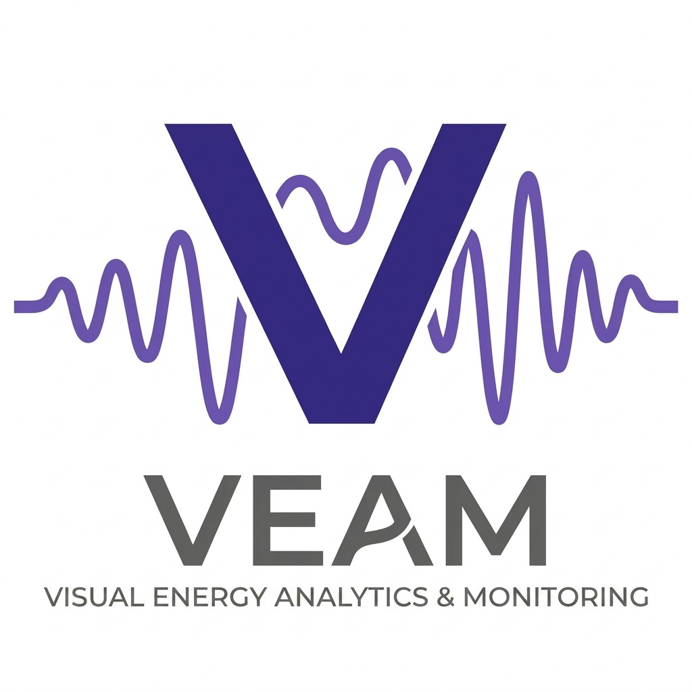
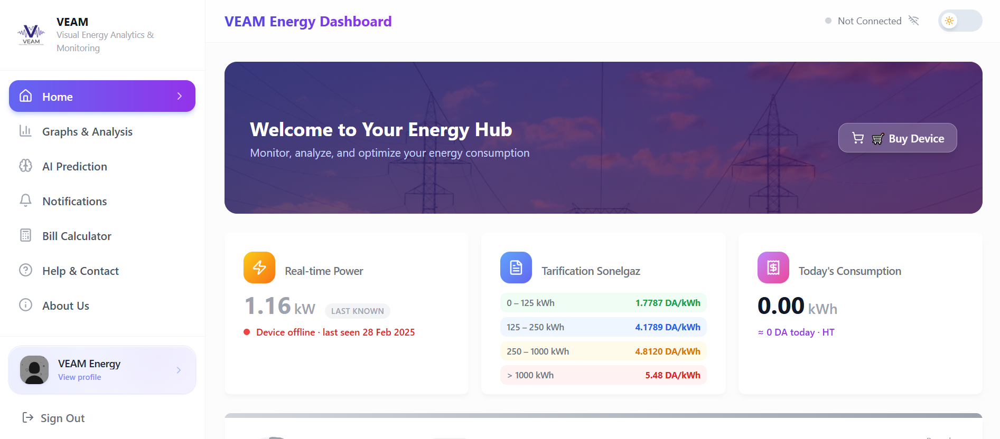
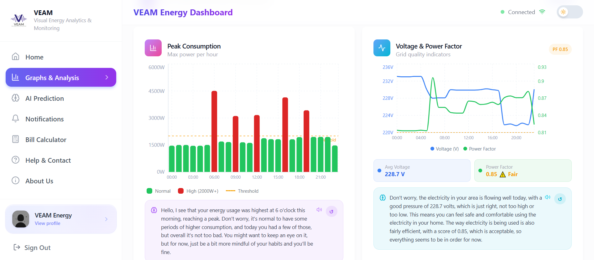
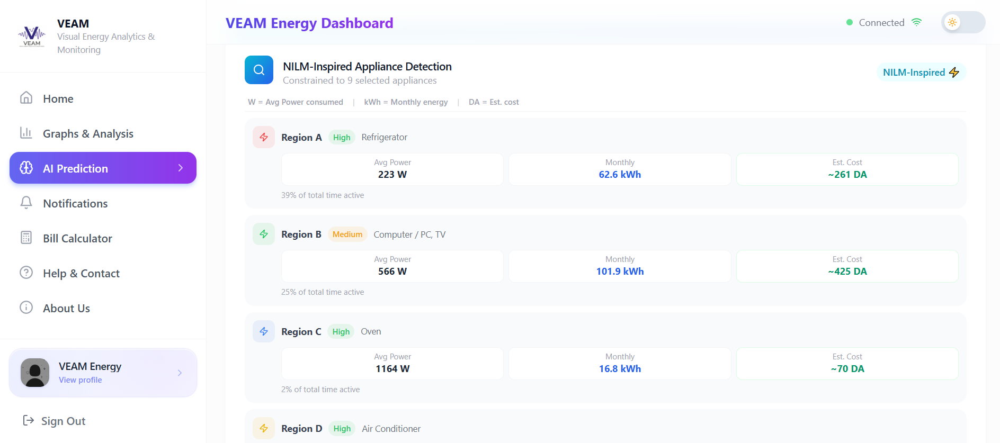
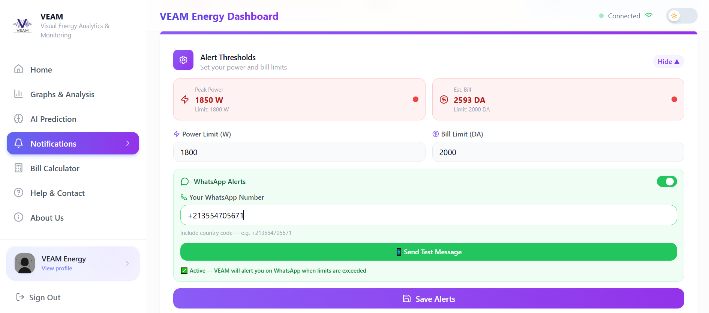
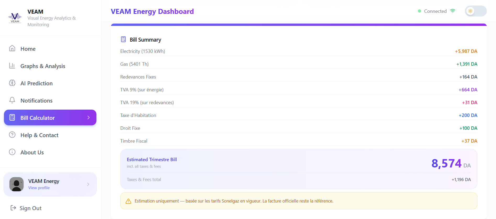
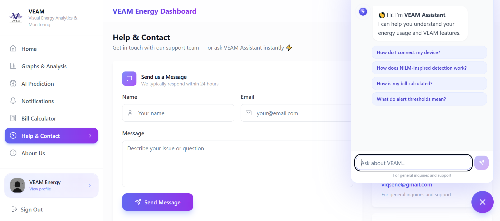

<div align="center">



# ⚡ VEAM — Visual Energy Analytics & Monitoring

**IoT-Based Energy Consumption Analysis using NILM-Inspired AI — Powered by Groq AI & ESP32**

[](https://veam-energy.vercel.app)
[](https://reactjs.org)
[](https://vercel.com)
[](https://groq.com)
[](LICENSE)

> A Master's graduation project — University of Souk Ahras, Algeria 🇩🇿

</div>

---

## 📸 Screenshots

| Dashboard | Graphs & Analysis |
|:---------:|:-----------------:|
|  |  |

| NILM-Inspired Detection | Notifications & WhatsApp |
|:-----------------------:|:------------------------:|
|  |  |

| Bill Calculator | Help & VEAM Assistant |
|:--------------:|:---------------------:|
|  |  |

---

## 📌 About

**VEAM** (Visual Energy Analytics & Monitoring) is a full-stack smart home energy monitoring system developed as a Master 2 graduation project.

The system combines **real IoT hardware** (ESP32 + PZEM-004T) with an **AI-powered web dashboard** to give Algerian households real-time insights into their electricity consumption, estimated Sonelgaz bills, and appliance-level energy analysis — all from a single current clamp sensor.

Using a **NILM-inspired approach**, Groq AI analyzes real power signatures (voltage, current, power factor) and estimates which appliances are likely running — without requiring a separate sensor on each device.

---

## ✨ Key Features

### 🏠 Real-Time Dashboard
- Live monitoring of **Voltage (V), Current (A), Power (W), Power Factor, Frequency (Hz)**
- Updates every **3 seconds** via ESP32 → Google Sheets → Dashboard
- **Sonelgaz Dynamic Tarification** — estimates monthly bill in real time
- **Energy Score** — rates consumption as Good / Fair / Poor
- Offline data buffering in ESP32 memory, auto-uploaded on reconnection

### 📊 Graphs & Analysis
- Real data from Google Sheets — no mock data
- Three time filters: **Day** (hourly) | **7 Days** (daily avg) | **Month** (30 days)
- Charts: Energy vs Time · Peak Consumption · Voltage & Power Factor
- **Groq AI explains each chart** in simple language for non-technical users
- 🔊 Text-to-speech button reads AI explanations aloud

### 🤖 AI Prediction (NILM-Inspired)
- **Estimated Monthly Bill** — projects cost based on current consumption rate
- **Potential Savings** — estimates savings if AI recommendations are followed
- **NILM-Inspired Appliance Detection** — segments live data into 5 power regions (A→E) using real event-based segmentation (actual elapsed time between readings, noise-debounced), then Groq AI + a deterministic rule engine infer which appliances are active — no appliance duplicated across regions, every user-selected appliance placed somewhere, confidence cross-checked against declared daily usage
- **Groq AI Recommendations** — 3 personalized energy-saving tips
- **Carbon Footprint** — CO₂ kg/month + equivalent km driven by car

### 🔔 Smart Notifications
- **Live Power & Electricity Cost** — read directly from Google Sheets (not simulated), with cost estimated via time-weighted energy integration + real Sonelgaz tranche rates (HT — see Bill Calculator for the full taxed estimate)
- Set **Power Limit (W)** and **Electricity Cost Limit (DA, HT)** thresholds
- Live alerts when limits are exceeded
- **WhatsApp Alerts** — VEAM sends a WhatsApp message to your phone number when limits are exceeded (powered by Twilio)
- **Device Connectivity Monitor** — detects when the ESP32 stops sending new readings (client-side check against the latest Google Sheets timestamp) and keeps a local history of past disconnections

### 🧮 Bill Calculator
- Estimates electricity & gas bill using **official Sonelgaz 2024 tariffs**
- Supports 1 Month / 2 Months / Trimestre (~70 day) billing periods
- Full breakdown: all tranches + TVA 9%/19% + Redevances Fixes + all taxes

### 💬 VEAM Assistant
- AI chatbot built into the Help page
- Knows everything about VEAM: setup, features, billing, NILM, alerts
- Powered by Groq AI (GPT-OSS 120B)

---

## 🧠 Technology Stack

| Layer | Technology |
|-------|-----------|
| **Frontend** | React 18 + TypeScript + Vite |
| **Styling** | Tailwind CSS + shadcn/ui |
| **Charts** | Recharts |
| **AI Engine** | Groq AI — GPT-OSS 120B |
| **NILM-Inspired** | Event-based segmentation + Groq AI inference + deterministic rule engine |
| **WhatsApp Alerts** | Twilio WhatsApp Sandbox API |
| **Backend API** | Vercel Edge Runtime (serverless functions) |
| **Data Source** | Google Sheets API (real ESP32 data) |
| **Hardware** | ESP32 + PZEM-004T V3.0 |
| **Deployment** | Vercel |

---

## ⚡ NILM-Inspired Detection — How It Works

```
Real Electrical Data (1 reading every 20 seconds via ESP32)
  Voltage · Current · Active Power · Power Factor · Frequency
                          ↓
         Power Region Segmentation (5 regions A→E)
         A: 0–400W  B: 400–800W  C: 800–1200W
         D: 1200–1700W  E: 1700W+
                          ↓
     Event-Based Segmentation (edge detection)
     Real elapsed time between timestamps + single-sample
     noise debounce → avg run duration (min) & occurrences/day
                          ↓
    User provides appliance list + expected usage hours
                          ↓
     Groq AI analyzes power signature AND temporal behavior
     per region (duration + frequency of ON events — not
     just average power) against the declared appliance list
                          ↓
     Deterministic rule engine (no LLM involved):
     • no appliance ever claimed by more than one region
     • every user-selected appliance placed somewhere,
       even if Groq never mentioned it
     • confidence cross-checked against the appliance's
       declared daily usage hours
                          ↓
    Output: Appliance · Avg Power · Monthly kWh · Est. Cost DA
```

> **Note:** This is a NILM-*inspired* hybrid approach: appliance classification combines real event-based signal segmentation (edge detection, run duration, occurrence frequency) with Groq AI (LLM-based inference) and a deterministic rule engine for de-duplication, full appliance coverage, and usage-based confidence scoring — not a trained ML model or dedicated NILM dataset. It is best described as *AI-assisted power + temporal signature analysis with rule-based validation*.

---

## 🏗️ System Architecture

```
[ESP32 + PZEM-004T]
        |
        | WiFi (every 3s)
        ↓
[Google Sheets] ←── Real electrical data
        |
        | Sheets API
        ↓
[Vercel Edge Functions]
        |
        ├── /api/gemini       → Groq AI (GPT-OSS 120B)
        └── /api/send-whatsapp → Twilio WhatsApp
        |
        ↓
[React Dashboard]
  Home · Graphs · AI Prediction · Notifications
  Bill Calculator · Help · About · Profile
```

---

## 📁 Project Structure

```
veam-energy/
├── api/
│   ├── gemini.ts              # Groq AI serverless function
│   └── send-whatsapp.ts       # Twilio WhatsApp serverless function
├── src/
│   ├── pages/
│   │   ├── Home.tsx           # Real-time dashboard
│   │   ├── GraphsAnalysis.tsx # Charts (real Google Sheets data)
│   │   ├── AIPrediction.tsx   # AI predictions + NILM-Inspired detection
│   │   ├── Notifications.tsx  # Alerts + WhatsApp integration
│   │   ├── BillCalculator.tsx # Sonelgaz bill estimator
│   │   ├── HelpContact.tsx    # VEAM Assistant chatbot
│   │   ├── AboutUs.tsx        # Project info
│   │   └── Profile.tsx        # User profile + report export
│   ├── lib/
│   │   ├── mockData.ts          # Fallback data
│   │   ├── sonelgazTariffs.ts   # Real Sonelgaz tranche/tax logic (shared by Bill Calculator & Notifications)
│   │   └── energyEstimate.ts    # Time-weighted energy integration from raw Power readings
│   └── components/ui/         # shadcn/ui components
├── vercel.json                # Vercel configuration
└── package.json
```

---

## 🚀 Getting Started

### Prerequisites
```bash
node >= 18
pnpm or npm
```

### Installation
```bash
git clone https://github.com/viqelt/veam-energy.git
cd veam-energy
npm install
```

### Environment Variables
Create a `.env` file:
```env
GROQ_API_KEY=your_groq_api_key
TWILIO_ACCOUNT_SID=your_twilio_sid
TWILIO_AUTH_TOKEN=your_twilio_token
TWILIO_WHATSAPP_FROM=whatsapp:+14155238886
```

### Run locally
```bash
npm run dev
```

---

## 🔧 Hardware

| Component | Model | Role |
|-----------|-------|------|
| Microcontroller | ESP32 | WiFi + data processing |
| Power Sensor | PZEM-004T V3.0 | Measures V, I, P, PF, Freq, kWh |
| Clamp | Open CT Sensor | Non-invasive current measurement |
| Data Storage | Google Sheets | Cloud backend |

---

## 🗺️ Roadmap / Future Work

The current release focuses on the core PFE deliverable: real IoT data, NILM-inspired AI classification, and Sonelgaz billing accuracy. The following is planned as a post-defense evolution toward the VEAM startup, not part of the current core system:

- **24/7 Device Health Monitoring via n8n** — the current Device Connectivity Monitor only runs while the dashboard is open (client-side check). An n8n workflow polling Google Sheets independently would detect ESP32 disconnections even when no one has the dashboard open, and trigger a WhatsApp alert automatically.

---

## 👨‍💻 Authors

<table>
  <tr>
    <td align="center">
      <strong>Oussama Benzaara</strong><br/>
      <a href="https://github.com/viqelt">@viqelt</a><br/>
      Master — Industrial Electrotechnics<br/>
      University of Souk Ahras, Algeria
    </td>
    <td align="center">
      <strong>Amina Touati</strong><br/>
      <a href="https://github.com/xalvirea">@xalvirea</a><br/>
      Master — Automatic Control & Industrial Computing<br/>
      University of Souk Ahras, Algeria
    </td>
  </tr>
</table>

---

## 📄 License

This project is licensed under the **MIT License** — see the [LICENSE](LICENSE) file for details.

Developed for academic purposes as a Master's graduation project (PFE) — University of Souk Ahras, Algeria.

---

<div align="center">

Built with ❤️ using React, Groq AI, ESP32, and NILM-inspired energy analysis

**University of Souk Ahras — 2026/2027**

</div>
